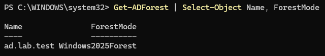
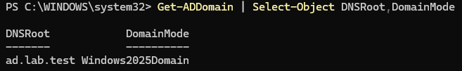
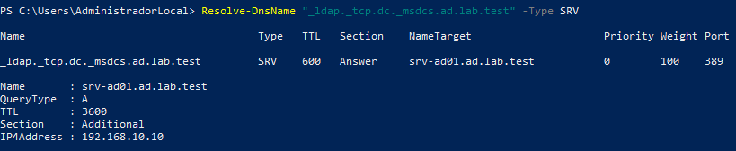

# Active Directory y DNS

## 1. Objetivo

He instalado y configurado Active Directory Domain Services (AD DS) en Windows Server 2025, creando un nuevo bosque y dominio para administrar de forma centralizada las identidades de una organización.

El servidor actúa como controlador de dominio y proporciona los servicios de directorio y resolución DNS necesarios para el entorno.

## 2. Entorno

| Parámetro | Configuración |
|---|---|
| Hipervisor | Oracle VirtualBox |
| Sistema operativo | Windows Server 2025 Standard Evaluation |
| Servidor | SRV-AD01 |
| Red virtual | NAT Network: Lab-AD |
| Red IPv4 | 192.168.10.0/24 |
| Dirección IP estática | 192.168.10.10 |
| Puerta de enlace | 192.168.10.1 |
| Servidor DNS | 192.168.10.10 |

## 3. Dominio y bosque

Instalé el rol Active Directory Domain Services y promoví el servidor a controlador de dominio, creando un nuevo bosque.

| Parámetro | Resultado |
|---|---|
| Nombre del bosque | ad.lab.test |
| Nombre del dominio | ad.lab.test |
| Nombre NetBIOS | AD |
| Controlador de dominio | SRV-AD01 |
| Nivel funcional del dominio | Windows2025Domain |
| Nivel funcional del bosque | Windows2025Forest |
| Catálogo global | Habilitado |

El entorno dispone actualmente de un único controlador de dominio.

### Comprobación de los niveles funcionales

Comprobé el nivel funcional del dominio mediante PowerShell:

```powershell
Get-ADDomain | Select-Object DNSRoot,DomainMode
```

El resultado confirmó:

- DNSRoot: `ad.lab.test`
- DomainMode: `Windows2025Domain`

También comprobé el nivel funcional del bosque, que corresponde a `Windows2025Forest`.

## 4. Configuración DNS

Instalé el servicio DNS junto con Active Directory. Las zonas principales creadas son:

- `ad.lab.test`
- `_msdcs.ad.lab.test`

Ambas zonas están integradas en Active Directory.

La interfaz de red del controlador de dominio utiliza su propia dirección IP (`192.168.10.10`) como servidor DNS.

### Reenviadores DNS

Configuré los siguientes reenviadores:

- `100.100.1.1`
- `100.90.1.1`

El servidor DNS utiliza estos reenviadores para resolver consultas externas.

## 5. DHCP y direccionamiento

La red NAT Network `Lab-AD` de VirtualBox mantiene habilitado su servidor DHCP integrado.

| Parámetro | Valor |
|---|---|
| Servidor DHCP | 192.168.10.2 |
| Máscara | 255.255.255.0 |
| Puerta de enlace | 192.168.10.1 |
| Rango dinámico inicial | 192.168.10.100 |
| Rango dinámico final | 192.168.10.200 |

La dirección `192.168.10.10` está configurada estáticamente en el controlador de dominio.

No he instalado el rol DHCP en Windows Server.

### Incidencia con la entrega DNS del DHCP

Durante la incorporación del equipo cliente detecté una discrepancia en la entrega de servidores DNS mediante DHCP.

Modifiqué la opción DHCP número 6 de la red `Lab-AD` para utilizar `192.168.10.10` como servidor DNS. La configuración de VirtualBox mostraba ese valor, pero el cliente continuaba recibiendo los servidores DNS anteriores (`100.100.1.1` y `100.90.1.1`).

Comprobé mediante `netsh` que estos valores procedían de DHCP y no de una configuración manual previa.

No he podido determinar la causa exacta de esta discrepancia entre la configuración mostrada en VirtualBox y los servidores DNS recibidos por el cliente.

Como solución operativa, mantuve la asignación IP automática mediante DHCP y configuré manualmente el servidor DNS del cliente:

```powershell
Set-DnsClientServerAddress -InterfaceAlias "Ethernet" -ServerAddresses 192.168.10.10
```

Posteriormente comprobé la resolución del registro SRV del controlador de dominio.

La resolución DNS del cliente quedó operativa, aunque la entrega de la opción DNS por DHCP de VirtualBox sigue pendiente de investigar.

## 6. Validación de servicios

Comprobé los siguientes servicios de Windows Server:

| Servicio | Función | Estado comprobado |
|---|---|---|
| NTDS | Servicios de dominio de Active Directory | Running |
| DNS | Servidor DNS | Running |
| Netlogon | Autenticación y registro de red | Running |
| ADWS | Servicios web de Active Directory | Running |

También verifiqué el inicio de sesión del administrador utilizando la cuenta del dominio:

- Cuenta: `AD\Administrador`

## 7. Validación DNS

### Localización del controlador de dominio

Comando utilizado:

```powershell
Resolve-DnsName "_ldap._tcp.dc._msdcs.ad.lab.test" -Type SRV
```

Resultado comprobado:

- Registro SRV localizado correctamente.
- Servidor de destino: `srv-ad01.ad.lab.test`
- Puerto LDAP: 389
- Dirección IPv4: `192.168.10.10`

Esta prueba confirma que DNS publica correctamente la información necesaria para localizar el servicio LDAP del controlador de dominio.

### Resolución DNS externa

Comando utilizado:

```powershell
Resolve-DnsName www.microsoft.com
```

Resultado: resolución correcta mediante registros CNAME y direcciones IP públicas.

Esta prueba confirma que el servidor DNS puede resolver nombres externos utilizando los reenviadores configurados.

### Validación desde el equipo cliente

Después de configurar manualmente el DNS del cliente, repetí la consulta del registro SRV:

```powershell
Resolve-DnsName "_ldap._tcp.dc._msdcs.ad.lab.test" -Type SRV
```

Obtuve como resultado el controlador `srv-ad01.ad.lab.test`, con dirección IP `192.168.10.10` y puerto LDAP 389.

Esto permitió comprobar que el cliente podía localizar el controlador de dominio antes de incorporarse a Active Directory.

## 8. Evidencias

### Nivel funcional del bosque



### Nivel funcional del dominio



### Resolución DNS interna


### Resolución DNS externa


### Localización del controlador desde el cliente



## 9. Conclusiones

He desplegado un controlador de dominio Windows Server 2025 con Active Directory Domain Services y DNS integrado.

He comprobado el funcionamiento de los servicios principales, la estructura DNS del dominio, la localización del controlador mediante registros SRV y la resolución de nombres externos.

También he configurado un equipo cliente para utilizar el DNS del controlador de dominio y he verificado que puede localizar los servicios de Active Directory.

Durante la configuración de red he identificado una discrepancia en la entrega de DNS mediante DHCP de VirtualBox. La resolución DNS del cliente quedó operativa al configurar manualmente `192.168.10.10` como servidor DNS, aunque la discrepancia en la entrega DHCP continúa pendiente de investigación.

El entorno constituye la base de la infraestructura empresarial desarrollada en este laboratorio.

