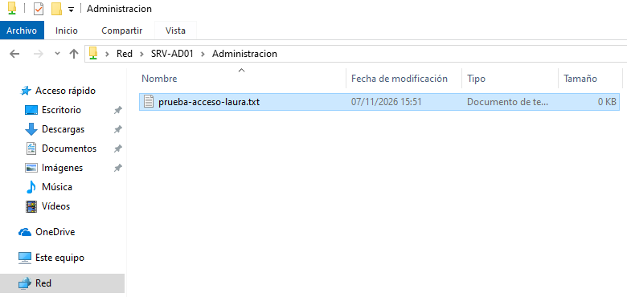
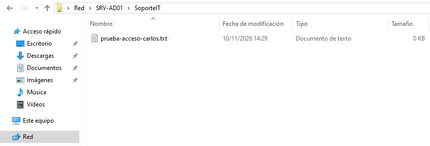
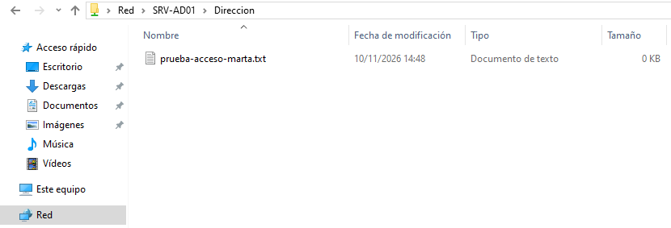
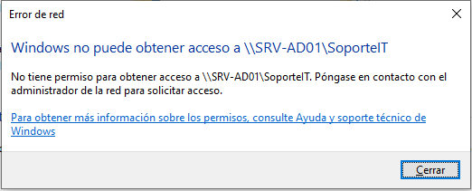
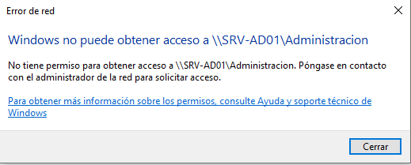
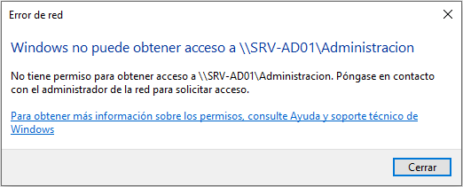
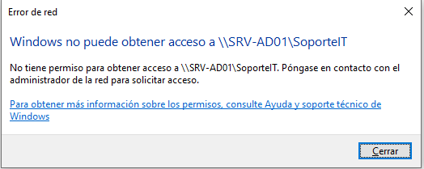
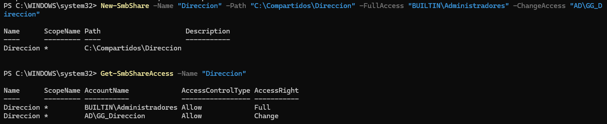
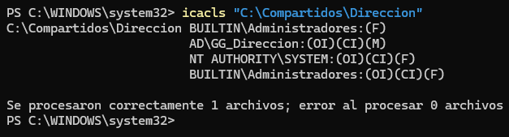

# Carpetas compartidas y permisos SMB/NTFS

## 1. Objetivo

He creado tres recursos compartidos en Windows Server 2025 para simular el acceso a documentos de una pequeña empresa organizada en tres departamentos.

El objetivo es administrar el acceso mediante grupos de seguridad de Active Directory, combinando permisos NTFS y permisos de recursos compartidos SMB.

He aplicado el principio de mínimo privilegio, permitiendo que cada departamento acceda a sus propios recursos sin conceder acceso general al resto de usuarios.

## 2. Entorno

| Parámetro | Configuración |
|---|---|
| Servidor | SRV-AD01 |
| Sistema operativo | Windows Server 2025 |
| Dominio | ad.lab.test |
| Equipo cliente | CLIENTE-W10 |
| Protocolo de compartición | SMB |
| Ruta principal | C:\Compartidos |

## 3. Estructura de carpetas

Creé la siguiente estructura en el controlador de dominio:

```text
C:\Compartidos
├── Administracion
├── SoporteIT
└── Direccion
```

Cada carpeta representa un departamento y se utiliza como destino de un recurso compartido de red.

## 4. Configuración de permisos NTFS

Antes de asignar los permisos, consulté las ACL de las carpetas mediante:

```powershell
Get-Acl C:\Compartidos\Administracion |
Format-List Owner,AccessToString
```

También utilicé `icacls` para consultar las entradas de control de acceso:

```powershell
icacls "C:\Compartidos\Administracion"
```

### 4.1. Diagnóstico de la herencia

Inicialmente, las carpetas heredaban permisos de `C:\Compartidos`.

Entre ellos se encontraban permisos del grupo `BUILTIN\Usuarios`, que incluían lectura y ejecución, además de permisos relacionados con la creación de archivos y directorios.

Para evitar mantener esos permisos generales en las carpetas departamentales, decidí desactivar la herencia en cada una.

Comando utilizado:

```powershell
icacls "C:\Compartidos\Administracion" /inheritance:r
```

Repetí el procedimiento en `SoporteIT` y `Direccion`.

El parámetro `/inheritance:r` desactiva la herencia y elimina las entradas heredadas de la ACL de la carpeta.

### 4.2. Asignación de permisos por departamento

Una vez desactivada la herencia, asigné permisos explícitos mediante `icacls`.

**Administración:**

```powershell
icacls "C:\Compartidos\Administracion" /grant:r "BUILTIN\Administradores:(OI)(CI)(F)" "NT AUTHORITY\SYSTEM:(OI)(CI)(F)" "AD\GG_Administracion:(OI)(CI)(M)"
```

**SoporteIT:**

```powershell
icacls "C:\Compartidos\SoporteIT" /grant:r "BUILTIN\Administradores:(OI)(CI)(F)" "NT AUTHORITY\SYSTEM:(OI)(CI)(F)" "AD\GG_SoporteIT:(OI)(CI)(M)"
```

**Dirección:**

```powershell
icacls "C:\Compartidos\Direccion" /grant:r "BUILTIN\Administradores:(OI)(CI)(F)" "NT AUTHORITY\SYSTEM:(OI)(CI)(F)" "AD\GG_Direccion:(OI)(CI)(M)"
```

### 4.3. Interpretación de la sintaxis

| Elemento | Significado |
|---|---|
| `icacls` | Consulta y modifica las listas de control de acceso NTFS. |
| `/inheritance:r` | Desactiva la herencia y elimina las ACE heredadas. |
| `/grant:r` | Concede permisos y sustituye las concesiones explícitas anteriores de las identidades indicadas. |
| `(F)` | Full Control: control total. |
| `(M)` | Modify: modificar. |
| `(OI)` | Object Inherit: propaga permisos a los archivos. |
| `(CI)` | Container Inherit: propaga permisos a las subcarpetas. |

El parámetro `/grant:r` no sustituye toda la ACL: afecta a las concesiones explícitas de las identidades especificadas.

He utilizado `(OI)(CI)` para que los permisos de los grupos departamentales se propaguen a los archivos y subcarpetas.

### 4.4. Resultado esperado de las ACL

| Carpeta | Identidad | Permiso NTFS |
|---|---|---|
| Administracion | AD\GG_Administracion | Modificar |
| SoporteIT | AD\GG_SoporteIT | Modificar |
| Direccion | AD\GG_Direccion | Modificar |
| Todas | BUILTIN\Administradores | Control total |
| Todas | NT AUTHORITY\SYSTEM | Control total |

Comprobé los permisos mediante `icacls` después de realizar las modificaciones.

## 5. Creación de los recursos compartidos SMB

Una vez configurados los permisos NTFS, publiqué las carpetas mediante el cmdlet `New-SmbShare`.

**Administración:**

```powershell
New-SmbShare -Name "Administracion" -Path "C:\Compartidos\Administracion" -FullAccess "BUILTIN\Administradores" -ChangeAccess "AD\GG_Administracion"
```

**SoporteIT:**

```powershell
New-SmbShare -Name "SoporteIT" -Path "C:\Compartidos\SoporteIT" -FullAccess "BUILTIN\Administradores" -ChangeAccess "AD\GG_SoporteIT"
```

**Dirección:**

```powershell
New-SmbShare -Name "Direccion" -Path "C:\Compartidos\Direccion" -FullAccess "BUILTIN\Administradores" -ChangeAccess "AD\GG_Direccion"
```

### 5.1. Verificación de permisos SMB

Utilicé `Get-SmbShareAccess` para consultar los permisos asignados a cada recurso compartido.

Ejemplo:

```powershell
Get-SmbShareAccess -Name "Administracion"
```

El resultado confirmó:

- `BUILTIN\Administradores`: Full.
- `AD\GG_Administracion`: Change.

Realicé la misma comprobación para `SoporteIT` y `Direccion`.

### 5.2. Diferencia entre permisos SMB y NTFS

Durante esta práctica comprobé que los permisos SMB y NTFS son dos capas independientes de control de acceso.

- Los permisos SMB controlan el acceso al recurso cuando se utiliza a través de la red.
- Los permisos NTFS controlan las operaciones permitidas sobre los archivos y directorios del sistema de archivos.

Para acceder a un recurso compartido, ambas capas deben permitir la operación solicitada. En caso de discrepancia, se aplica la restricción más limitante.

### 5.3. Relación con el modelo de seguridad de Azure

Durante esta práctica he relacionado el funcionamiento conjunto de los permisos SMB y NTFS con el modelo de seguridad por capas de Azure Network Security Groups (NSG).

De forma similar a cuando una máquina virtual tiene asociados NSG tanto en su subred como en su interfaz de red (NIC), donde el tráfico debe estar permitido en ambos niveles, el acceso a un recurso compartido requiere superar tanto los permisos SMB como los permisos NTFS.

En ambos casos, una autorización en una capa no compensa una restricción existente en la otra.

Esta relación me ha permitido conectar conceptos de administración de permisos de Windows con los mecanismos de filtrado de tráfico que estudié durante la preparación de AZ-104.

## 6. Validación desde el equipo cliente

Utilicé `CLIENTE-W10`, unido al dominio `ad.lab.test`, para comprobar los accesos con las cuentas de los tres departamentos.

Accedí a los recursos mediante las rutas UNC:

```text
\\SRV-AD01\Administracion
\\SRV-AD01\SoporteIT
\\SRV-AD01\Direccion
```

### 6.1. Matriz de pruebas

| Usuario | Administración | SoporteIT | Dirección |
|---|---|---|---|
| Laura Garcia | Permitido | Denegado | No probado |
| Carlos Ruiz | Denegado | Permitido | No probado |
| Marta Lopez | Denegado | Denegado | Permitido |

### 6.2. Pruebas de escritura

En cada recurso autorizado comprobé que el usuario podía crear un archivo de prueba.

Archivos utilizados:

- `prueba-acceso-laura.txt`
- `prueba-acceso-carlos.txt`
- `prueba-acceso-marta.txt`

Estas pruebas permitieron comprobar que los usuarios no solamente podían visualizar las carpetas, sino también realizar operaciones de escritura autorizadas.

### 6.3. Resultados

Las siete pruebas realizadas confirmaron los siguientes resultados:

- Laura puede acceder a Administración, pero no a SoporteIT.
- Carlos puede acceder a SoporteIT, pero no a Administración.
- Marta puede acceder a Dirección, pero no a Administración ni SoporteIT.

De las siete pruebas realizadas, tres fueron accesos permitidos y cuatro fueron accesos denegados.

No se han realizado pruebas de acceso de Laura ni Carlos al recurso de Dirección.

Los accesos permitidos se comprobaron mediante la creación de archivos de prueba. Los accesos denegados se verificaron mediante las respuestas de Windows.

## 7. Evidencias

### Accesos permitidos

**Laura – Administración**



**Carlos – SoporteIT**



**Marta – Dirección**



### Accesos denegados

**Laura – SoporteIT**



**Carlos – Administración**



**Marta – Administración y SoporteIT**





### Configuración de permisos de Dirección





## 8. Conclusiones

He configurado tres recursos compartidos, uno por departamento, utilizando grupos de seguridad de Active Directory para centralizar la asignación de permisos.

He aplicado permisos NTFS mediante `icacls` y he configurado los permisos de los recursos compartidos con `New-SmbShare`.

Finalmente, he validado el comportamiento desde Windows 10 Pro mediante siete pruebas de acceso: tres permitidas y cuatro denegadas. Los resultados confirman que los usuarios pueden trabajar con los recursos de su departamento y que los accesos probados a los otros departamentos son denegados.

Los accesos de Laura y Carlos al recurso de Dirección no se han probado, por lo que no se incluyen entre los resultados.

Esta práctica me ha permitido comprender la diferencia entre permisos NTFS y SMB, la importancia de la herencia de permisos y la utilidad de administrar los accesos mediante grupos de seguridad.

También he comprobado cómo una configuración de permisos puede verificarse desde el servidor y desde el equipo cliente, en lugar de darla por válida únicamente porque se haya aplicado correctamente.