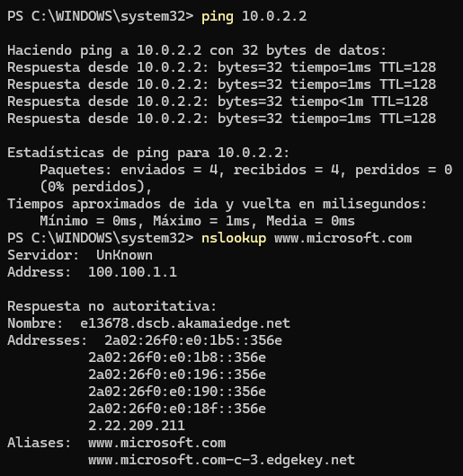
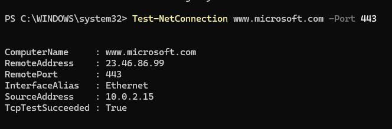
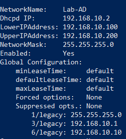
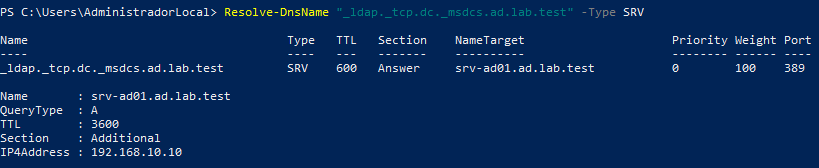

# Diagnóstico de conectividad de red

## 1. Objetivo

He realizado pruebas de conectividad para comprobar la comunicación entre el servidor, la puerta de enlace virtual y servicios externos.

Posteriormente, he ampliado las comprobaciones al incorporar un equipo cliente al dominio, verificando el direccionamiento DHCP, la configuración DNS y la localización del controlador de dominio.

## 2. Entorno de laboratorio

### 2.1. Configuración inicial

Durante las primeras pruebas utilicé la configuración NAT predeterminada de VirtualBox.

| Parámetro | Valor |
|---|---|
| Servidor | SRV-AD01 |
| Sistema operativo | Windows Server 2025 Standard Evaluation |
| Hipervisor | Oracle VirtualBox |
| Modo de red | NAT |
| Dirección IPv4 | 10.0.2.15 |
| Puerta de enlace | 10.0.2.2 |

Posteriormente modifiqué la arquitectura de red para utilizar una red NAT Network independiente denominada `Lab-AD`.

### 2.2. Configuración actual

| Parámetro | Valor |
|---|---|
| Red virtual | Lab-AD |
| Tipo | NAT Network |
| Subred | 192.168.10.0/24 |
| Puerta de enlace | 192.168.10.1 |
| Servidor DHCP | 192.168.10.2 |
| Rango DHCP | 192.168.10.100–192.168.10.200 |
| IP estática del servidor | 192.168.10.10 |

El servidor DHCP pertenece a VirtualBox. No he instalado el rol DHCP en Windows Server.

## 3. Pruebas iniciales de conectividad

Las siguientes comprobaciones se realizaron durante la fase inicial, utilizando la configuración NAT predeterminada.

### 3.1. Conectividad con la puerta de enlace

Comando:

```powershell
ping 10.0.2.2
```

Resultado:

- 4 paquetes recibidos.
- 0 % de pérdida.

Interpretación:

El servidor respondió correctamente a las solicitudes ICMP dirigidas a la puerta de enlace virtual.

### 3.2. Resolución DNS

Comando:

```powershell
nslookup www.microsoft.com
```

Resultado:

La consulta devolvió direcciones IP asociadas al nombre solicitado.

Interpretación:

La resolución DNS funcionó correctamente en el momento de la prueba. El mensaje `Servidor: UnKnown` no impidió completar la consulta.

### 3.3. Conectividad TCP con HTTPS

Comando:

```powershell
Test-NetConnection www.microsoft.com -Port 443
```

Resultado:

`TcpTestSucceeded: True`

Interpretación:

Se estableció correctamente una conexión TCP con el destino en el puerto 443.

## 4. Configuración de la red Lab-AD

Posteriormente configuré una red NAT Network denominada `Lab-AD` para permitir la comunicación entre el controlador de dominio y el equipo cliente.

El servidor utiliza una dirección IPv4 estática:

`192.168.10.10/24`

El DHCP integrado de VirtualBox proporciona automáticamente la configuración IP a los clientes dentro del rango:

`192.168.10.100–192.168.10.200`

La puerta de enlace virtual es `192.168.10.1`.

## 5. Incidencia con la configuración DNS del cliente

Durante la incorporación de Windows 10 Pro al dominio detecté que el cliente recibía una configuración DNS que no correspondía al controlador de dominio.

El resultado inicial de `ipconfig /all` mostraba:

- Dirección IPv4: 192.168.10.100.
- Máscara: 255.255.255.0.
- Puerta de enlace: 192.168.10.1.
- Servidor DHCP: 192.168.10.2.
- Servidores DNS: 100.100.1.1 y 100.90.1.1.

La dirección IP, la máscara, la puerta de enlace y el servidor DHCP eran correctos, pero los servidores DNS recibidos no correspondían al controlador de dominio.

### 5.1. Diagnóstico

Comprobé la configuración DNS mediante:

```powershell
Get-DnsClientServerAddress -InterfaceAlias "Ethernet" -AddressFamily IPv4
```

También utilicé:

```powershell
netsh interface ipv4 show dnsservers "Ethernet"
```

Las comprobaciones confirmaron que los servidores DNS anteriores estaban siendo proporcionados mediante DHCP y no configurados manualmente en el adaptador.

Intenté modificar la opción DHCP número 6 de la red `Lab-AD` desde VirtualBox mediante `VBoxManage`. También reinicié el servicio DHCP y probé la opción de forzar la entrega de la configuración.

La captura de configuración de VirtualBox muestra la opción DNS configurada con `192.168.10.10`. Sin embargo, el cliente continuó recibiendo los servidores DNS anteriores (`100.100.1.1` y `100.90.1.1`).

Por tanto, la configuración mostrada en VirtualBox no se correspondía con los servidores DNS que estaba recibiendo el cliente.

No pude determinar la causa definitiva de esta discrepancia.

### 5.2. Solución aplicada

Para permitir que el cliente localizase el controlador de dominio, mantuve la asignación automática de IP y configuré manualmente el servidor DNS.

Comando utilizado:

```powershell
Set-DnsClientServerAddress -InterfaceAlias "Ethernet" -ServerAddresses 192.168.10.10
```

Después comprobé la configuración mediante:

```powershell
Get-DnsClientServerAddress -InterfaceAlias "Ethernet" -AddressFamily IPv4
```

Resultado:

`192.168.10.10`

La configuración permitió que el cliente utilizase el servicio DNS del controlador de dominio.

La entrega de la opción DNS mediante DHCP queda pendiente de investigar. La solución aplicada es operativa para este laboratorio, pero no constituye una corrección definitiva de la configuración DHCP.

## 6. Validación DNS del dominio desde el cliente

Una vez configurado el DNS del cliente, comprobé si podía localizar el controlador de dominio mediante el registro SRV de LDAP.

Comando utilizado:

```powershell
Resolve-DnsName "_ldap._tcp.dc._msdcs.ad.lab.test" -Type SRV
```

Resultado:

| Parámetro | Valor |
|---|---|
| Registro SRV | _ldap._tcp.dc._msdcs.ad.lab.test |
| Servidor de destino | srv-ad01.ad.lab.test |
| Puerto LDAP | 389 |
| Dirección IPv4 | 192.168.10.10 |

Esta consulta confirmó que el cliente podía localizar el servicio LDAP del controlador de dominio mediante DNS.

Esta comprobación se realizó antes de unir `CLIENTE-W10` al dominio `ad.lab.test`.

## 7. Observación sobre la dependencia DNS

Al utilizar `192.168.10.10` como único servidor DNS del cliente, la resolución de nombres depende de que `SRV-AD01` y su servicio DNS estén disponibles.

Durante las pruebas observé que, con el servidor apagado, el cliente no podía resolver nombres externos para acceder a ellos mediante su nombre de dominio.

Al arrancar el controlador de dominio, la resolución DNS volvió a estar disponible.

Esto demuestra la importancia de mantener operativo el servicio DNS en un entorno de Active Directory, especialmente cuando los equipos cliente utilizan el controlador de dominio como servidor DNS.

## 8. Evidencias

### Conectividad inicial con la puerta de enlace y resolución DNS



### Comprobación de conectividad y puerto HTTPS



### Configuración DHCP de la red Lab-AD



### Resolución DNS interna desde el controlador de dominio


### Resolución DNS externa desde el controlador de dominio


### Localización del controlador de dominio desde Windows 10



## 9. Conclusiones

He comprobado la conectividad inicial del servidor, la resolución DNS y la comunicación TCP con un servicio HTTPS externo.

Posteriormente he desplegado una red virtual independiente para comunicar el controlador de dominio con un equipo cliente.

Durante la incorporación del cliente detecté una discrepancia entre la opción DNS configurada en VirtualBox y los servidores DNS proporcionados mediante DHCP. Apliqué una configuración DNS manual en Windows 10 y comprobé que podía localizar correctamente el controlador de dominio mediante registros SRV.

Las pruebas permitieron verificar la conectividad y la resolución DNS necesarias para incorporar el equipo cliente a Active Directory.

La incidencia relativa a la entrega DNS mediante DHCP permanece pendiente de investigación.

