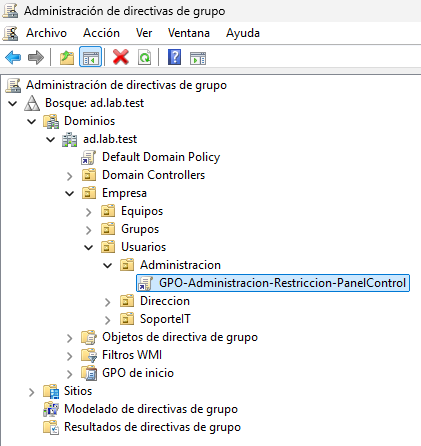
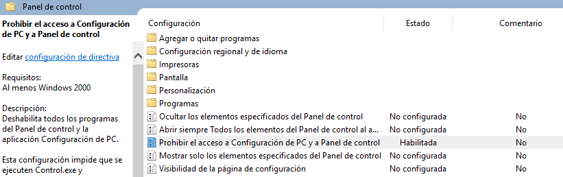
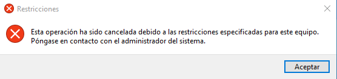
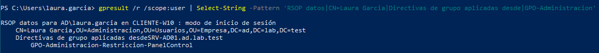

# Directivas de grupo (GPO) en Active Directory

## 1. Objetivo

He creado y configurado una directiva de grupo (GPO) para administrar determinadas restricciones de usuario dentro del dominio `ad.lab.test`.

El objetivo de esta práctica es comprobar cómo las directivas de grupo permiten aplicar configuraciones de forma centralizada a los usuarios organizados en unidades organizativas (OU).

## 2. Entorno

| Parámetro | Configuración |
|---|---|
| Servidor | SRV-AD01 |
| Sistema operativo | Windows Server 2025 |
| Dominio | ad.lab.test |
| Equipo cliente | CLIENTE-W10 |
| Usuario de prueba | AD\laura.garcia |
| Unidad organizativa | OU=Administracion |

## 3. Creación y vinculación de la GPO

He creado la siguiente directiva desde la consola de Administración de directivas de grupo (`gpmc.msc`):

`GPO-Administracion-Restriccion-PanelControl`

La he vinculado directamente a la siguiente unidad organizativa:

`OU=Administracion,OU=Usuarios,OU=Empresa`

De esta forma, la configuración de usuario se aplica dentro del ámbito de esa OU, de acuerdo con el procesamiento de directivas de grupo y sus filtros de seguridad.

### Evidencia: GPO vinculada a la OU



## 4. Configuración de la directiva

Desde el Editor de administración de directivas de grupo configuré la siguiente opción:

**Ruta de configuración:**

```text
Configuración de usuario
  > Directivas
    > Plantillas administrativas
      > Panel de control
```

**Directiva:** Prohibir el acceso al Panel de control y a Configuración del PC.

Establecí su estado en `Habilitada`.

Esta configuración restringe el acceso del usuario al Panel de control y a la aplicación Configuración de Windows.

### Evidencia: configuración de la directiva



## 5. Actualización de las directivas en el cliente

Después de configurar la GPO, inicié sesión en `CLIENTE-W10` utilizando la cuenta de dominio:

`AD\laura.garcia`

Ejecuté el siguiente comando desde PowerShell:

```powershell
gpupdate /force
```

Este comando fuerza la actualización de las directivas de grupo de usuario y equipo.

El resultado indicó que ambas actualizaciones finalizaron correctamente:

- Actualización de la directiva de equipo completada correctamente.
- Actualización de la directiva de usuario completada correctamente.

## 6. Validación de la GPO

Para comprobar que la directiva se había aplicado realmente, realicé dos pruebas.

### 6.1. Comprobación funcional

Desde la sesión de Laura intenté abrir el Panel de control mediante:

```powershell
control
```

Windows impidió el acceso debido a la restricción configurada.

Esta prueba permitió comprobar el efecto visible de la GPO sobre el usuario.



### 6.2. Comprobación mediante gpresult

Posteriormente ejecuté:

```powershell
gpresult /r /scope:user
```

Este comando genera un informe de las directivas de grupo aplicadas al usuario actual.

El resultado confirmó:

- Usuario: `AD\laura.garcia`.
- Equipo: `CLIENTE-W10`.
- Controlador de dominio: `SRV-AD01.ad.lab.test`.
- Unidad organizativa: `Administracion`.
- GPO aplicada: `GPO-Administracion-Restriccion-PanelControl`.

La directiva apareció dentro del apartado de objetos de directiva de grupo aplicados.



## 7. Conclusiones

He creado y vinculado una directiva de grupo a una unidad organizativa de Active Directory para restringir el acceso al Panel de control.

He comprobado su funcionamiento desde un equipo cliente unido al dominio y he verificado su aplicación mediante `gpresult`.

Esta práctica me ha permitido comprender cómo las GPO facilitan la administración centralizada de configuraciones de usuario dentro de una organización.

También he comprobado la importancia de distinguir entre configurar una directiva, actualizarla en el cliente y verificar que se ha aplicado correctamente.