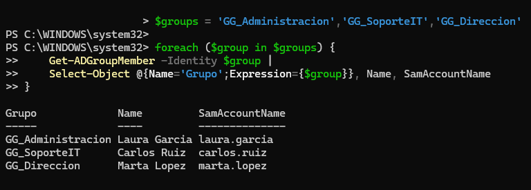
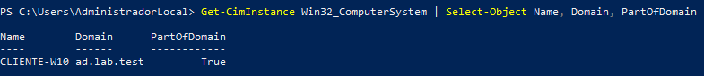
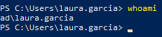

# Administración de usuarios y grupos en Active Directory

## 1. Objetivo

He organizado una empresa ficticia mediante unidades organizativas (OU), creado cuentas de usuario y grupos de seguridad y establecido una estructura básica para administrar identidades y permisos de forma centralizada mediante Active Directory.

## 2. Estructura organizativa

He creado la siguiente estructura dentro del dominio `ad.lab.test`:

```text
ad.lab.test
└── Empresa
    ├── Usuarios
    │   ├── Administracion
    │   ├── SoporteIT
    │   └── Direccion
    ├── Equipos
    └── Grupos
        ├── GG_Administracion
        ├── GG_SoporteIT
        └── GG_Direccion
```

Los elementos situados dentro de `Grupos` son objetos de grupo de seguridad, no unidades organizativas.

Las OU permiten organizar los objetos del directorio, facilitar la administración y establecer ámbitos para la aplicación de directivas de grupo (GPO).

## 3. Usuarios creados

He creado tres cuentas de usuario ficticias, una por departamento.

| Nombre | Usuario | Unidad organizativa |
|---|---|---|
| Laura Garcia | laura.garcia | Administracion |
| Carlos Ruiz | carlos.ruiz | SoporteIT |
| Marta Lopez | marta.lopez | Direccion |

Las tres cuentas se han utilizado posteriormente para comprobar la autenticación y el acceso a los recursos compartidos desde el equipo cliente.

## 4. Grupos de seguridad

He creado tres grupos de seguridad con ámbito global:

| Grupo | Ámbito | Tipo |
|---|---|---|
| GG_Administracion | Global | Seguridad |
| GG_SoporteIT | Global | Seguridad |
| GG_Direccion | Global | Seguridad |

Los grupos permiten centralizar la asignación de permisos sin tener que configurar cada usuario individualmente en los recursos.

## 5. Asociación de usuarios a grupos

He establecido las siguientes pertenencias:

| Usuario | Grupo |
|---|---|
| laura.garcia | GG_Administracion |
| carlos.ruiz | GG_SoporteIT |
| marta.lopez | GG_Direccion |

He comprobado las pertenencias mediante las herramientas gráficas de Active Directory y consultas de PowerShell.

## 6. Validación mediante PowerShell

Utilicé PowerShell para consultar los miembros de los tres grupos de seguridad.

**Comando utilizado:**

```powershell
$groups = 'GG_Administracion','GG_SoporteIT','GG_Direccion'

foreach ($group in $groups) {
    Get-ADGroupMember -Identity $group |
    Select-Object @{Name='Grupo';Expression={$group}}, Name, SamAccountName
}
```

La consulta devolvió correctamente los tres usuarios y sus respectivos grupos.

### 6.1. Comprobación individual de pertenencia a grupos

También se verificó la pertenencia de Marta Lopez mediante el cmdlet `Get-ADPrincipalGroupMembership`:

```powershell
Get-ADPrincipalGroupMembership marta.lopez |
Select-Object Name
```

**Resultado obtenido:**

```text
Name
----
Usuarios del dominio
GG_Direccion
```

El resultado confirma que la cuenta `marta.lopez` pertenece al grupo global de seguridad `GG_Direccion`, además del grupo predeterminado `Usuarios del dominio`.

## 7. Validación desde el equipo cliente

He unido el equipo `CLIENTE-W10` al dominio `ad.lab.test` y he comprobado la pertenencia mediante:

```powershell
Get-CimInstance Win32_ComputerSystem |
Select-Object Name, Domain, PartOfDomain
```

El resultado confirmó:

- Nombre del equipo: `CLIENTE-W10`.
- Dominio: `ad.lab.test`.
- PartOfDomain: `True`.

También he iniciado sesión utilizando cuentas del dominio y comprobado la identidad autenticada mediante:

```powershell
whoami
```

Por ejemplo, al iniciar sesión con Laura, el resultado fue:

```text
ad\laura.garcia
```

## 8. Relación con permisos y directivas de grupo

Los grupos creados sirven como base para administrar el acceso a los recursos departamentales.

He utilizado estos grupos para establecer permisos sobre las carpetas compartidas mediante SMB y NTFS:

- `GG_Administracion`: acceso a Administración.
- `GG_SoporteIT`: acceso a SoporteIT.
- `GG_Direccion`: acceso a Dirección.

También he creado una directiva de grupo vinculada a la OU `Administracion`, restringiendo el acceso al Panel de control y a Configuración de Windows.

He comprobado su aplicación desde la sesión de Laura mediante `gpresult`.

## 9. Evidencias

### Usuarios y grupos de seguridad



### Unión del cliente al dominio



### Inicio de sesión con un usuario del dominio



## 10. Conclusiones

He creado una estructura organizativa básica para una empresa ficticia mediante Active Directory.

He organizado los usuarios en unidades organizativas y los he asociado a grupos de seguridad globales según su departamento.

He verificado las pertenencias mediante PowerShell y he comprobado la autenticación desde un equipo cliente unido al dominio.

Esta estructura ha servido como base para aplicar directivas de grupo y configurar permisos sobre recursos compartidos.

Una de las principales ventajas de este modelo es poder administrar los permisos mediante grupos, simplificando la gestión cuando se incorporan nuevos usuarios o se producen cambios de departamento.

